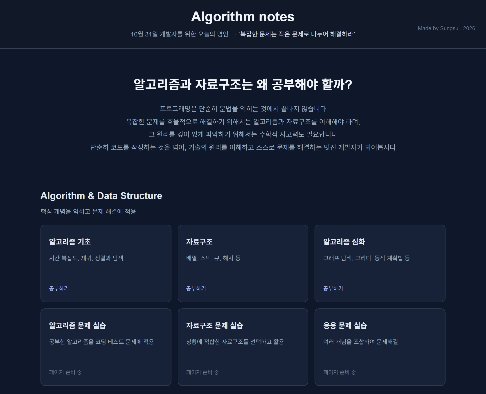
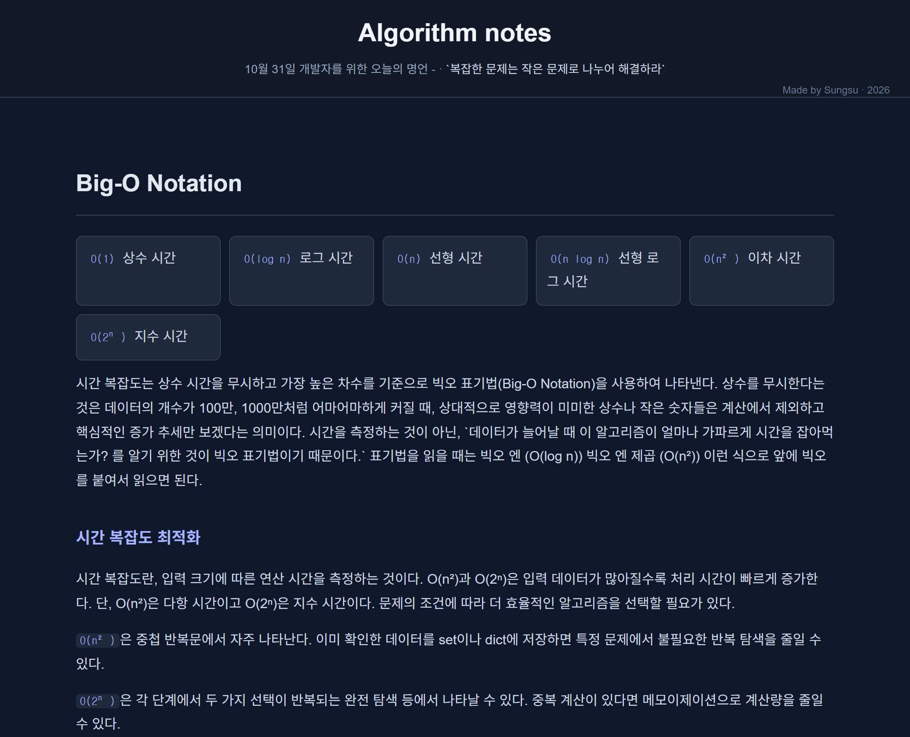

# Algorithm Notes

 

[한국어로 보기](./README.md)

**Website:** [Visit Website](https://iamsungsu.github.io/algorithm-notes/)  
**Status:** Ongoing

 

---

## 01 / PROJECT OVERVIEW

**Algorithm Notes** は、アルゴリズム問題の解決に必要な理論や、データ構造の動作原理を学習できるように制作したWebサイトです。 
単なる概念の説明にとどまらず、各アルゴリズムやデータ構造の仕組み、内部原理を理解することに重点を置いています。

## 02 / WEBSITE PREVIEW

<h3 align="center">01. MAIN PAGE</h3>

  Overview · Topic Navigation · Learning Categories

  

 

<h3 align="center">02. STUDY PAGE</h3>

  Concepts · Algorithm Analysis · Code Examples

  

---

## 03 / LEARNING CONTENTS

| CATEGORY | TOPICS |
|:---|:---|
| **Algorithm Basics** | 時間計算量、空間計算量、アルゴリズム解析 |
| **Data Structures** | 配列、連結リスト、スタック、キュー、木構造 |
| **Algorithms** | ソートアルゴリズム、探索アルゴリズム |
| **Mathematics** | アルゴリズムや機械学習に必要な数学的概念 |

## 04 / TECH STACK

| TECHNOLOGY | DESCRIPTION |
|:---|:---|
| HTML5 | Webページの構造およびコンテンツの構築 |
| CSS3 | レイアウトおよびデザインの実装 |
| JavaScript | Webページの動的な動作の実装 |
| Git | バージョン管理 |
| GitHub | ソースコード管理 |
| GitHub Pages | Webサイトの公開およびホスティング |

---

### `Segmentation Fault: Brain Overflow (⊙_⊙;)`

 

*Personal Educational Project · 2026*

